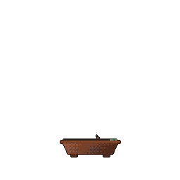

### Hey, I'm Tvisha 🤝

Welcome to my corner of GitHub! I lead design at [Strawberry.me](https://strawberry.me), where I design 0→1 products, AI-assisted workflows, and dual-sided marketplaces.

When I'm not designing, you can find me building tiny tools, losing hours in Minecraft, or getting bullied by my family's cat.

🎨 **Website:** [tvishapatel.com](https://tvishapatel.com)

📫 [LinkedIn](https://www.linkedin.com/in/tvishapatel-10/) · [Email](mailto:tvishapatel0@gmail.com)

#### Fun things I've built
- 🌐 [**My portfolio**](https://github.com/tvisha-patel-10/tvisha-portfolio): designed and coded from scratch with Astro and CSS (yes, I made my own cursor)
- 🪪 [**Badgecraft**](https://github.com/tvisha-patel-10/badge-craft): design your own name tag to share
- 🎹 [**Piano Pal**](https://github.com/tvisha-patel-10/piano-pal): a chord practice tool, because my synth days never left me
- 🎨 [**Hue Hunt**](https://github.com/tvisha-patel-10/hue-hunt): think you have a good eye for colors? Try to recreate a color from memory

🌱 Every commit I push grows this little tree:

Always down to chat about design, cool products, or where to eat next
